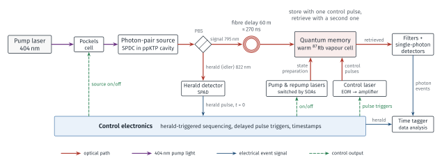
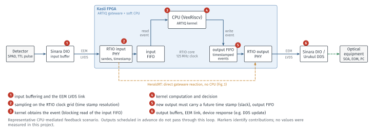
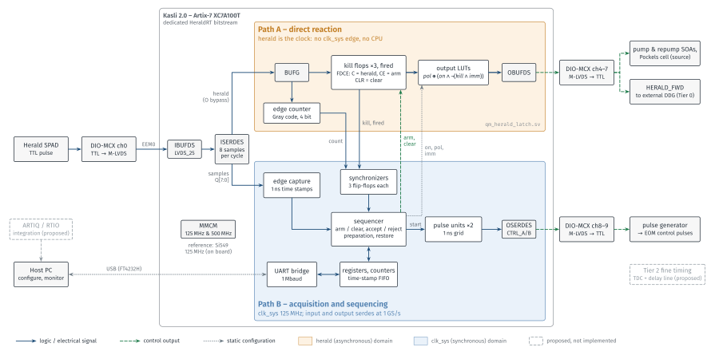
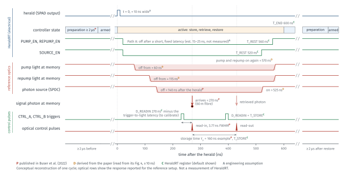

# HeraldRT

**Event-Driven FPGA Control for Quantum Experiments**

HeraldRT is a SystemVerilog controller that reacts to a single external
event — the detection of a *herald* photon — in dedicated hardware.

A single herald trigger drives two separate hardware paths:
- **Path A** switches laser and photon-source signals off without any processor,
  software or system-clock edge in the path.
- **Path B**, a synchronous path, time-stamps the same event, sequences the rest
  of the experiment and reports to a host.

The design targets a [Sinara Kasli 2.0](https://github.com/sinara-hw/Kasli/wiki)
(AMD Artix-7 XC7A100T) with a DIO-MCX digital I/O card. It is designed around the
control requirements of a published quantum-memory experiment.

> **Status in one line:** the design is simulated (800 self-checks pass),
> synthesised, placed and routed with the open-source openXC7 flow, and a
> bitstream is generated. **It has not yet run on hardware.** No latency or
> jitter has been measured, and Vivado timing sign-off is still open. See
> [Verification status](#7-verification-status).

---

## 1. The experiment

The reference is Buser *et al.*,
[*Single-Photon Storage in a Ground-State Vapor Cell Quantum Memory*](https://arxiv.org/abs/2204.12389)
(2022). It stores single photons in a warm rubidium vapour cell and retrieves them
later.


*Figure 1 – Simplified schematic of the reference experiment (original drawing based on the paper's description).*

- **Photon pairs.** A violet pump laser (404 nm) drives a nonlinear crystal in an
  optical cavity (spontaneous parametric down-conversion). Occasionally it emits
  a *pair* of photons at the same instant: a **signal** photon at 795 nm, which
  is the one to be stored, and an **idler** photon at 822 nm.
- **Herald.** The idler goes to a single-photon detector. A detector click
  *heralds* that a signal photon now exists and is on its way. The click is a
  random, asynchronous electrical pulse. It is the event this project is about.
- **Optical delay.** The signal photon travels through about 60 m of fibre and
  reaches the memory **≈ 270 ns** after the herald. Those 270 ns are the whole
  time budget the electronics have to react.
- **Memory.** Before a photon can be stored, pump and repump lasers prepare the
  atoms in one quantum state for **at least 2 µs**. These beams must be **off**
  while a photon is stored; otherwise they add noise and destroy the stored
  state.
  - A strong optical **control pulse (3.77 ns FWHM)** maps the arriving photon
    into the atoms.
  - A second control pulse after the **storage time** (160 ns in the paper's main
    example) retrieves it.
- **Source switching.** A Pockels cell also switches the photon source off
  during retrieval, to suppress unrelated background photons.

The paper performs this cycle about 1.5 × 10⁵ times per second. Its herald
reaction uses a commercial digital delay generator with 21 ns insertion delay and
< 35 ps RMS jitter.

## 2. The timing challenge

The experiment needs two very different kinds of timing:

| Requirement | What matters | Order of magnitude |
|---|---|---|
| **Shut off** pump, repump and source after a herald, and keep them off until retrieval | A short, *reliable* latency and a persistent state after a ~10 ns pulse | Tens of ns. In the paper the light is effectively off ≈ 60–140 ns after the herald, dominated by the optical switches. |
| **Align** the control pulses with the photon | Low jitter of the pulse relative to the herald | Well below the detector's > 350 ps jitter; the paper's chain reached 126 ps |

This distinction drives the whole design:
- **Not every operation needs picosecond precision.** The shutdown only has to be
  fast and guaranteed.
- **The alignment is the precision problem.** An FPGA that counts clock cycles
  from an asynchronous event adds a uniform quantisation error of one clock
  period: 2.3 ns RMS at 8 ns, 289 ps RMS at 1 ns.
- **Electrical edges are not optical edges.** SOAs, Pockels cells and EOMs add
  their own latencies. Each output must therefore be calibrated against the
  light it controls.

The [timing diagram](#figure-4) shows one complete cycle.

## 3. Background: ARTIQ and Sinara

[ARTIQ](https://m-labs.hk/experiment-control/artiq/) is the standard open-source
control system for atomic-physics experiments. On a Kasli board the FPGA contains:
- the RTIO core, which executes *time-stamped* input and output events with
  nanosecond resolution;
- a soft CPU (VexRiscv) that runs compiled experiment kernels.

Outputs scheduled *in advance* are timed precisely by gateware.


*Figure 2 – A representative CPU-mediated feedback scenario. The numbered markers identify latency contributions; none were measured in this project.*

Reacting to an *unpredictable* external event is different: the input event is
time-stamped, a kernel reads it, decides, and writes a new output event, which
must carry a future time stamp (*slack*). The reaction then includes kernel time,
clock-grid quantisation, FIFO and EEM-link transfers, and the output electronics
(an Urukul DDS, for example, needs an SPI transfer before its output changes).

This is an **architectural concern from our earlier investigation, not a measured
deficiency of ARTIQ.** That investigation proposed moving the critical path into
dedicated FPGA logic, possibly with a custom I/O board and programmable delay
lines. HeraldRT implements the dedicated logic on stock Sinara hardware; the custom
board and delay lines remain proposals.

## 4. Our approach: one trigger, two paths


*Figure 3 – HeraldRT as implemented in `rtl/`. Dashed grey blocks are proposals.*

**Path A — direct reaction** ([`qm_herald_latch.sv`](rtl/qm_herald_latch.sv),
output logic in [`qm_core.sv`](rtl/qm_core.sv)):
- **The herald is the clock of a few flip-flops (FDCE).** Its rising edge sets the
  *kill* flops for pump, repump and source and a *fired* flag; the state persists
  after the pulse ends. One LUT per output applies polarity and masking,
  `out = pol ⊕ (on ∧ ¬(kill ∧ imm))`. The route is herald input → global clock
  buffer → flop → LUT → output buffer, with no CPU and no system-clock edge.
  Estimated latency, not measured: ≈ 8–9 ns inside the FPGA (from routed delays),
  ≈ 15–25 ns connector to connector including the DIO-MCX buffers (Figure 4).
- **Arm, trigger, re-arm.** The flops are armed through their clock enable (`arm`)
  and cleared through their asynchronous clear, both driven by synchronous logic.
  Clears change only while `arm` is low, so a herald at a clear release is
  harmless. The remaining race, a herald inside `arm`'s setup/hold window, is
  resolved consistently because Path B treats the *synchronised `fired` flag* as
  the single truth.
- **Risks of an asynchronous clock:** metastability at the arming edge, a minimum
  pulse width, clock-enable skew between flops, and limited open-source timing
  analysis. All are analysed in [docs/05](docs/05_hardware_readiness.md).

**Path B — acquisition and control** (synchronous, 125 MHz system clock):
- An input serdes samples the herald at 1 GS/s, giving **1 ns time stamps**.
  [`qm_edge_capture.sv`](rtl/qm_edge_capture.sv)
- A Gray-coded counter, itself clocked by the herald, counts *every* edge,
  including pulses too short to be sampled. The edge counts reconcile exactly:
  `edges = accepted + rejected + race`, and `raw = edges + unseen`.
- The **sequencer** ([`qm_sequencer.sv`](rtl/qm_sequencer.sv)):
  - enforces the ≥ 2 µs preparation and rejects heralds while not armed;
  - pairs the accepted herald with its time stamp;
  - schedules the read-in / read-out triggers on a 1 ns output grid
    ([`qm_pulse_unit.sv`](rtl/qm_pulse_unit.sv));
  - restores the beams at programmable times;
  - re-arms.
- **Host link.** Counters, a 64-entry time-stamp FIFO and a register file are
  reachable through a 1 Mbaud UART ([`qm_regs.sv`](rtl/qm_regs.sv),
  [`qm_uart.sv`](rtl/qm_uart.sv)), using [`tools/qmctl.py`](tools/qmctl.py).

**Separation of responsibilities.** Once armed, the shutdown happens in hardware
whether or not any software ever reads the event. The host only configures and
observes.

**Timing tiers for the control pulses:**

| Tier | Mechanism | Status |
|---|---|---|
| 0 | Forward the gated herald (`HERALD_FWD`) to an external delay generator, as in the paper | Output implemented; external DDG required |
| 1 | FPGA-generated triggers on a 1 ns serdes grid (≈ 289 ps RMS quantisation) | **Implemented and simulated.** Not precise enough for final photon alignment. |
| 2 | TDC phase measurement plus an external programmable delay line (e.g. MC100EP195B, 10 ps steps) | **Proposal only** |

<a id="figure-4"></a>

*Figure 4 – One storage-and-retrieval cycle, reconstructed from the paper and the HeraldRT register defaults. Tags: P published, D derived from the paper, C configurable, A assumption. Not a measurement.*

## 5. Hardware platform

| Item | Selection |
|---|---|
| FPGA carrier | Sinara Kasli 2.0: AMD Artix-7 **XC7A100T-3FGG484**, Si549 reference (125 MHz assumed, to be confirmed at bring-up), FT4232H USB (JTAG + UART) |
| Digital I/O | Sinara **DIO-MCX (2238)**: 16 MCX channels, 50 Ω-capable, connected over EEM LVDS |
| Lab equipment | herald SPAD; SOA drivers, Pockels-cell driver, pulse generator / EOM (as in the paper) |

**Why this platform:**
- a mature FPGA architecture and free tools;
- laboratory-grade digital I/O without a custom PCB;
- the same hardware ecosystem as ARTIQ, which gives a path to later integration.

HeraldRT runs as a **dedicated bitstream**; its critical path does not depend on
the ARTIQ runtime. Pin assignments were checked against the Kasli v2.0.2
schematic ([constraints](constr/kasli_v2_0.xdc)).

**Open hardware questions** (from schematics and datasheets, see
[docs/05](docs/05_hardware_readiness.md)):
- **Input threshold:** the SPAD's 2.2 V typical / 1.5 V minimum output against the
  DIO-MCX buffer's 2.0 V threshold.
- **LVDS termination:** the receiver termination (DIFF_TERM) is missing in
  open-flow bitstreams.
- **Undefined outputs during configuration:** DIO-MCX outputs are undefined while
  the FPGA is not yet configured.
- **Unverified on real boards:** signal polarity on every channel, the board
  revision, and all propagation delays.

**No hardware has been purchased, programmed or measured for this project yet.**

## 6. Implementation

| Module | Responsibility |
|---|---|
| [`qm_herald_latch`](rtl/qm_herald_latch.sv) | Path A flops (herald-clocked), Gray edge counter |
| [`qm_edge_capture`](rtl/qm_edge_capture.sv) | 1 ns edge detection and time stamps from the serdes |
| [`qm_sequencer`](rtl/qm_sequencer.sv) | arm / clear protocol, accept / reject, scheduling, restore, preparation |
| [`qm_pulse_unit`](rtl/qm_pulse_unit.sv) | wrap-safe 1 ns pulse generation (two pipeline stages) |
| [`qm_cfg_check`](rtl/qm_cfg_check.sv) | registered consistency check; an invalid cycle is never armed |
| [`qm_regs`](rtl/qm_regs.sv), [`qm_fifo`](rtl/qm_fifo.sv) | configuration, status, counters, time-stamp FIFO |
| [`qm_uart`](rtl/qm_uart.sv) | host register access |
| [`qm_sync`](rtl/qm_sync.sv) | clock-domain synchronisers |
| [`qm_xilinx7_io`](rtl/vendor/xilinx7/qm_xilinx7_io.sv) | **all** AMD primitives: MMCM, ISERDESE2, OSERDESE2, LVDS buffers |
| [`qm_top`](rtl/qm_top.sv) | Kasli 2.0 / DIO-MCX pin-level top |

Module names use the prefix `qm_` (quantum memory).

**Decisions worth noting:**
- **Vendor isolation.** Every vendor primitive is confined to one wrapper, which
  has behavioural models of the same name for simulation.
- **Refinement driven by place-and-route.** The open-source flow exposed real
  125 MHz critical paths, each fixed in RTL: the pulse comparison was split into
  two pipeline stages with a registered nanosecond base counter; configuration
  validation was registered and applied to the frozen snapshot; absolute event
  times are precomputed when a herald is accepted. The scheduler compensates the
  added latency, so simulated timing stays exact to the nanosecond.
  The host read mux and the configuration check were split into two registered
  levels; regression tests pin the arming latency (T_PREP + 4 cycles) and the
  UART reply timing, both unchanged.
- **A tool-induced defect was caught by netlist review.** Yosys had packed the
  three-stage clock-domain synchronisers into SRL16E shift registers, despite
  `ASYNC_REG`. They are now forced to be flip-flops (`-nosrl`, `SHREG_EXTRACT`),
  and a script checks this on every build.

## 7. Verification status

| Item | Result | Evidence |
|---|---|---|
| Functional simulation (Verilator) | **800 checks, 0 errors**; mutation tests show the bench detects broken Path A logic and one-cycle latency errors | [`tb/tb_qm_top.sv`](tb/tb_qm_top.sv), [docs/03](docs/03_verification_and_validation.md) |
| Lint (Verilator `-Wall`) | clean | `make lint` |
| Synthesis (Yosys, XC7) | maps; 11 herald-clocked FDCE, no SRL in synchronisers | `make yosys` |
| Place & route (openXC7, xc7a100tfgg484-3) | routes. Default seed: **138.8 MHz estimated** vs 125 MHz target. 12 seeds: 124.5–147.7 MHz, **11 of 12 pass**; worst seed 0.4 % short. | `make openxc7`, [docs/04](docs/04_build_environments.md) |
| Bitstream | generated (3.8 MB). Independent decode reproduces identical frames. **No configuration CRC.** | `make bitstream-check` |
| Path A structure (post-route) | herald → BUFG → FDCE → LUT → OBUFDS, no system-clock element in the path | `scripts/analyze_herald_path.py` |
| Build host | runs natively on an Apple M5 MacBook Air; full scripted flow ≈ 23–39 s | – |
| Vivado timing sign-off | **not done** | – |
| Hardware test, latency, jitter, electrical compatibility | **not done** | plan in [docs/03](docs/03_verification_and_validation.md) §3 |

The timing figures above are nextpnr *estimates*. nextpnr does not honour the
design's clock-domain-crossing and pad-to-pad constraints, and it does not time
the herald-driven nets at all. Only Vivado static timing analysis and measurements
on the board can establish those numbers.

## 8. Quick start

Prerequisites:
- Verilator ≥ 5 (with `--timing`) and Yosys, for simulation and synthesis;
- the openXC7 toolchain for place and route, built by `make openxc7-setup`;
- LuaLaTeX and Poppler, for the figures only.

```bash
make sim            # self-checking testbench (≈ 1 s)
make openxc7-setup  # one-time: build nextpnr-xilinx + Project X-Ray (~2 min)
make openxc7        # synthesis, P&R, bitstream, Path A review
make figures        # rebuild documentation figures (LuaLaTeX + TikZ -> SVG)
```

Vivado (x86-64 Linux, local or over SSH) and programming are covered in
[docs/04](docs/04_build_environments.md) and [docs/03](docs/03_verification_and_validation.md).

## 9. Limitations and next steps

1. Gain margin on the remaining near-critical sequencer paths: 1 of 12 seeds
   misses 125 MHz by 0.4 % on the `timer` compare
   ([docs/04 §3.3](docs/04_build_environments.md)).
2. Run Vivado for timing sign-off, CDC analysis, DIFF_TERM and a configuration CRC.
3. Make outputs safe during FPGA configuration. Recommended: gateware-controlled
   DIO-MCX direction.
4. Derive all Path A outputs from one herald flip-flop, to remove the
   inter-channel arming race.
5. Bench bring-up, then latency and jitter measurement with a ps-class time tagger
   ([docs/05](docs/05_hardware_readiness.md) §5).
6. Tier 2 fine timing, if the measured alignment requires it.

## 10. Future work: a DSL for event-driven hardware

The long-term goal is for a scientist to describe an experiment like this:

```text
on rising(herald) {
    immediate { pump = low; repump = low; }
    at storage_delay                { pulse control for pulse_width; }
    at storage_delay + storage_time { pulse control for pulse_width; }
}
```

A compiler would then generate experiment-specific FPGA logic from it. Each
construct already corresponds to a hardware mechanism in HeraldRT, with its own
timing class:

| Construct | Mechanism | Timing class |
|---|---|---|
| `on rising(herald)` | herald-clocked capture plus arming | asynchronous |
| `immediate` | Path A flip-flops | asynchronous |
| `at T` | sequencer events | 8 ns grid |
| `pulse` | serdes pulse units | 1 ns grid |

A compiler must reason about exactly these classes, for example by rejecting a
50 ps requirement without Tier 2 hardware.

**The DSL and the compiler do not exist yet.** This controller is the first step
towards understanding which abstractions and timing constraints they need
([docs/02 §7](docs/02_architecture.md)).

## 11. Documentation

| Document | Content |
|---|---|
| [01 Requirements and hardware](docs/01_requirements_and_hardware.md) | experiment analysis, classified timing parameters, platform comparison, BOM |
| [02 Architecture](docs/02_architecture.md) | asynchronous design rules, timing concepts, tiers, ARTIQ integration, DSL mapping |
| [03 Verification and validation](docs/03_verification_and_validation.md) | testbench, synthesis, measurement plan |
| [04 Build environments](docs/04_build_environments.md) | openXC7 (native macOS), Vivado via container / SSH |
| [05 Hardware readiness](docs/05_hardware_readiness.md) | schematic review, netlist and bitstream review, bring-up checklist |
| [Figures](docs/figures/) | LuaLaTeX/TikZ sources; `make figures`, `make figures-check` |

## Licence

| Part | Licence |
|---|---|
| RTL (`rtl/`, `sim/`, `tb/`), constraints, scripts, tools, container and build files | [Apache License 2.0](LICENSE) |
| Documentation (`README.md`, `docs/*.md`) and the original figures (`docs/figures/*.tex`, `*.svg`) | [CC BY 4.0](LICENSE-DOCS) |

Source files and generated figures carry an `SPDX-License-Identifier`; the
complete mapping, including the documentation files, and the third-party notes
are in [NOTICE](NOTICE).

## References

- G. Buser, R. Mottola, B. Cotting, J. Wolters, P. Treutlein, *Single-Photon
  Storage in a Ground-State Vapor Cell Quantum Memory*, arXiv:2204.12389 (2022).
  <https://arxiv.org/abs/2204.12389>
- ARTIQ: <https://m-labs.hk/experiment-control/artiq/> ·
  Sinara hardware: <https://github.com/sinara-hw>
- openXC7 toolchain: <https://github.com/openXC7> ·
  Project X-Ray: <https://github.com/f4pga/prjxray>
- AMD DS181, *Artix-7 FPGAs Data Sheet: DC and AC Switching Characteristics*.

---

HeraldRT is an independent project. It is not affiliated with or endorsed by the
authors of the reference paper, their institutions, M-Labs, the Sinara project or
any other organisation mentioned here.
